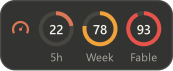
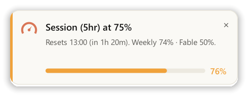

# Claude Usage Meter

A small Windows app that keeps your **Claude plan usage** in sight: a usage bar on your desktop, a ring in the tray, and a pop-up every time a limit passes another 25%.

   




- **Desktop meter**: Session (5hr), Weekly and per-model weekly (e.g. Fable), in Claude's colours. Two styles: a **compact** card with mini rings, or a **full bar** with labels and reset time. Place it top-left, top-right, top-centre, bottom-left or bottom-right from the tray menu, or drag it.
- **Desktop layer or on top**: by default the meter sits on the desktop behind your apps. Turn on *Keep on top of apps* and it floats above everything, slightly see-through and **click-through**, so it never blocks what you are doing (and stays below window title bars).
- **Pop-up alerts** at 25 / 50 / 75 / 100% for every limit, once per window, with an optional sound. Steps are configurable.
- **Ring + percentage** in the tray: clay, amber at 75%, red at 90% (configurable).
- **Right-click menu**: tokens and estimated cost for the current window, when it resets, burn rate, today's and the last 7 days' totals, and your top model.
- **Runs quietly in the background**: about 25 MB of memory, re-reads the logs every 60 seconds and only reads what was added since the last check.
- **Exact plan usage** (optional): with your claude.ai session key it shows the official Session (5hr), Weekly and per-model weekly bars, the same figures claude.ai shows.
- **Private by design**: without a session key it only reads the log files Claude Code already writes on your machine, with no network access. With a key, it talks only to claude.ai. No telemetry.
- **Single file, no installer**: one `.exe`, optional *Start with Windows*.

> Not affiliated with or endorsed by Anthropic. Numbers are estimates computed from local logs.

## Install

1. Download `claude-usage-meter.exe` from the [latest release](../../releases/latest).
2. Run it. The icon appears in the notification area.
   On Windows 11, new icons start hidden behind the **^** arrow: drag it onto the taskbar, or turn it on in
   *Settings → Personalization → Taskbar → Other system tray icons*.
3. Right-click the icon and tick **Start with Windows** if you want it running all the time.

Windows SmartScreen may warn about an unsigned download. Choose *More info → Run anyway*, or build it yourself (below).

## Exact plan usage from claude.ai (recommended)

Out of the box the meter estimates from local logs. To show the **same bars claude.ai and Claude Code show** (Session 5hr, Weekly 7 day, Weekly Fable / Opus / Sonnet, with reset times), give it your claude.ai session key:

1. Open [claude.ai](https://claude.ai) in your browser and sign in.
2. Press **F12** → **Application** (Chrome/Edge) or **Storage** (Firefox) → **Cookies** → `https://claude.ai`.
3. Copy the value of the **`sessionKey`** cookie (it starts with `sk-ant-sid`).
4. Right-click the tray icon → **Settings…**, paste it into `"claudeAiSessionKey": "..."`, save.

Within a minute the menu switches to **Claude plan usage (from claude.ai)** and the ring shows your Session (5hr) percentage. The ring turns amber or red when *any* bar (for example the weekly limit) crosses your thresholds.

**About the session key**
- It gives full access to your claude.ai account. Treat it like a password and never share your `config.json`.
- It is stored only in `%APPDATA%\ClaudeUsageMeter\config.json`, is sent only to `claude.ai`, and is never logged.
- It stops working when you log out of claude.ai; paste a fresh one if the menu says it was rejected.
- The usage endpoint (`/api/organizations/{org}/usage`) is the one the claude.ai web app uses, the same approach as the [Claude Usage Extension](https://github.com/lugia19/Claude-Usage-Extension). It is not a documented public API and may change; if it fails, the meter falls back to the local estimate and says so.

## Custom icon

The meter uses a generic gauge icon. To use your own, save a single-path SVG as `%APPDATA%\ClaudeUsageMeter\logo.svg` (1200x1200 viewBox, absolute `M`/`L`/`C`/`Z` path commands) and restart the meter. It is used in the tray, the desktop meter and the pop-ups. No third-party logos are shipped with this project.

## What the numbers mean

Claude Code logs every model response, with its token usage, to `%USERPROFILE%\.claude\projects\**\*.jsonl`. The meter reads those files and:

| Shown | How it is computed |
|---|---|
| **Current 5-hour window** | Requests are grouped into 5-hour windows. A window starts at the hour of its first request and lasts five hours; a gap of five hours also starts a new one. |
| **Tokens** | input + output + cache-write tokens. Cache reads are shown separately because they are cheap and would swamp the total. |
| **Percentage** | Tokens in the current window ÷ your limit. Anthropic does not publish plan limits as token counts, so by default the limit is **your own largest window** in the last 8 days (`blockTokenLimit: 0`). Set your own number in Settings. |
| **Cost** | API-equivalent estimate from list prices (USD per million tokens). Subscription plans are not billed this way; treat it as "what this would cost on the API". |
| **Burn rate** | Tokens per minute since the window's first request. |

Each response is counted once even when Claude Code logs it several times.

## Settings

**Right-click → Settings…** opens `%APPDATA%\ClaudeUsageMeter\config.json`. Changes apply at the next refresh.

```json
{
  "refreshSeconds": 60,
  "blockTokenLimit": 0,
  "scanDays": 8,
  "warnPercent": 60,
  "alertPercent": 85,
  "claudeDirs": [],
  "prices": {
    "claude-opus-5-5": { "input": 4, "output": 20, "cacheWrite5m": 5, "cacheWrite1h": 8, "cacheRead": 0.2 }
  }
}
```

| Key | Meaning |
|---|---|
| `refreshSeconds` | How often logs are re-read (minimum 10). |
| `blockTokenLimit` | Token budget for one 5-hour window. `0` = your largest recent window. |
| `scanDays` | How many days of logs to read. |
| `warnPercent` / `alertPercent` | When the ring turns amber / red. |
| `claudeDirs` | Folders that contain Claude Code's `projects` folder. Empty = `CLAUDE_CONFIG_DIR`, or `~/.claude` and `~/.config/claude`. |
| `widgetEnabled` | Show the desktop meter (also in the tray menu). |
| `widgetStyle` | `compact` (mini rings) or `bar` (full bar). |
| `widgetPosition` | `top-left`, `top-right`, `top-center`, `bottom-left`, `bottom-right`, or `custom` (set automatically when you drag it). |
| `widgetOnTop` | Float above other apps, click-through. Turning it on also turns the meter on. |
| `widgetOpacity` | Opacity when on top, 0.3–1 (default 0.85). |
| `widgetX` / `widgetY` | Where you dragged the meter (used when `widgetPosition` is `custom`). |
| `alertsEnabled` | Pop-up alerts (also in the tray menu). |
| `alertSteps` | Percentages that trigger a pop-up, e.g. `[25, 50, 75, 100]` or `[50, 80, 90, 95, 100]`. Each fires once per limit per window. |
| `alertSound` | Play the Windows warning sound with each pop-up. |
| `alertSeconds` | How long a pop-up stays up (click it to dismiss early). |
| `claudeAiSessionKey` | Your claude.ai `sessionKey` cookie, for exact plan usage (see above). Empty = local estimate only. |
| `organizationId` | Optional claude.ai organization UUID. Empty = the first chat organization on your account. |
| `prices` | Override or add prices (USD per 1M tokens). Keys are model ids or prefixes; the longest match wins. Built-in defaults cover current Fable, Mythos, Opus, Sonnet and Haiku models. |

## Console report

`claude-usage-report.exe` prints the same numbers in a terminal, or JSON with `-json`:

```
Current 5-hour window  34% used (of your largest window, 3.59M tokens)
  Tokens   1.25M  (+6.82M cache reads)
  Cost     $21.29 (API-equivalent estimate)
  Resets   12:30 (in 4h 02m)
  Burn     65.6k tokens/min

Today        1.25M tokens  $21.29  13 requests  top model: claude-opus-5-5
Last 7 days  14.63M tokens  $322  1348 requests  top model: claude-opus-5-5
```

## Build from source

Requires Go 1.26+ on Windows.

```powershell
go test ./...
go build -trimpath -ldflags "-H windowsgui -s -w" -o claude-usage-meter.exe .
go build -trimpath -ldflags "-s -w" -o claude-usage-report.exe ./cmd/claude-usage-report
```

`-H windowsgui` stops a console window from opening with the tray app.

## Project layout

```
main_windows.go             tray app: menu, refresh loop, alerts
overlay_windows.go          desktop bar and pop-up windows (Win32 layered windows)
winsys_windows.go           single instance, Start with Windows (HKCU Run key)
internal/ui/                draws the bar and pop-up in Claude's palette (tested)
internal/alerts/            25%-step alert logic, once per window (tested)
internal/official/          claude.ai plan usage client and parser (tested)
internal/usage/             log scanner, 5-hour windows, pricing (tested)
internal/trayicon/          draws the ring icon and encodes it as .ico (tested)
internal/config/            config.json load/save
internal/format/            number formatting
cmd/claude-usage-report/    console version
```

## Contributing

Issues and pull requests are welcome, especially for price updates, macOS/Linux tray support (the `usage` package is already cross-platform), and toast notifications at thresholds. Please run `go vet ./...` and `go test ./...` before opening a PR.

## License

[MIT](LICENSE)
